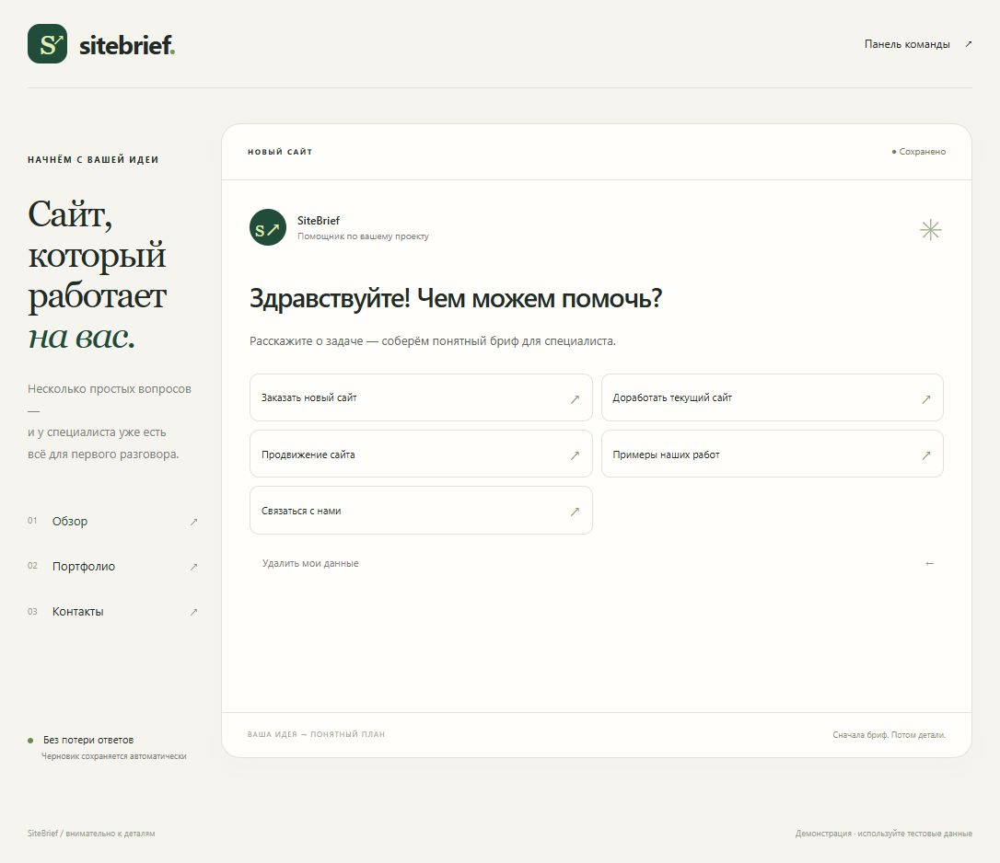
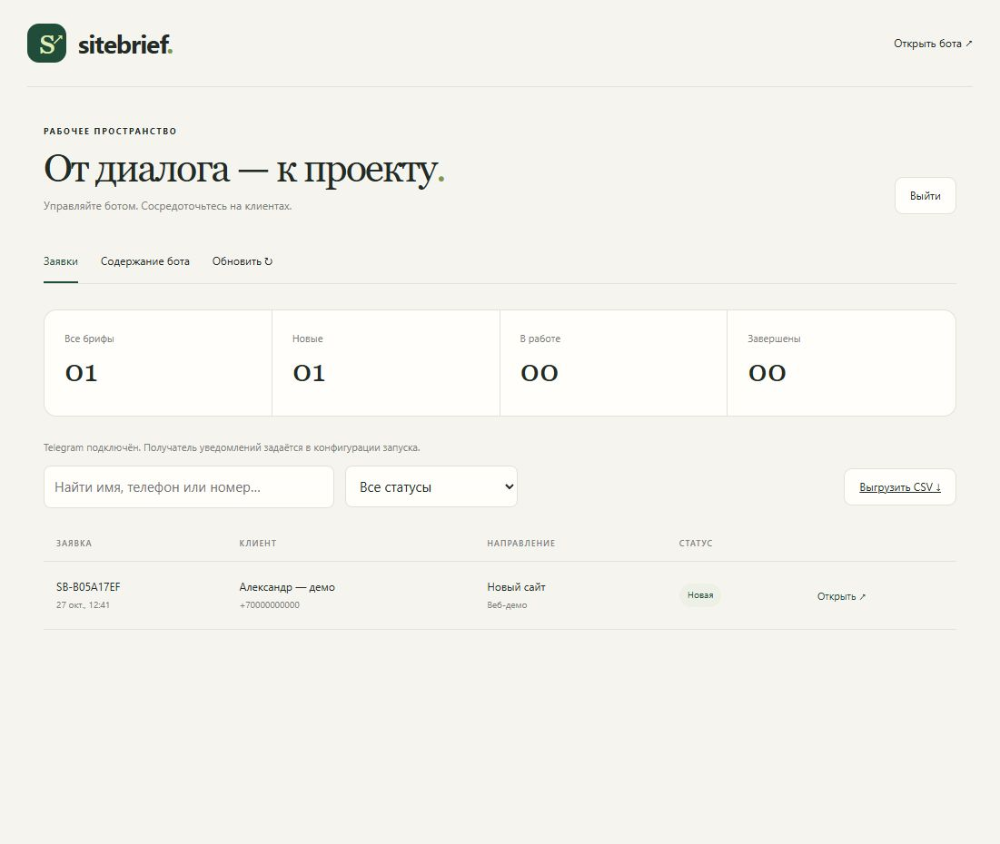

# SiteBrief

Чат-бот, который превращает запрос на сайт, доработку или продвижение в структурированный бриф. Реализован сценарий из тестового задания: все основные ветки, мультивыбор, уточнения, файлы, портфолио и контакты. Заказчик управляет содержанием через защищённую веб-панель.

**Telegram-демонстрация:** https://t.me/SiteBrief_Kbikx_bot

Бот размещён на бесплатном Bot-Hosting.net и работает независимо от компьютера автора. Демо: https://sitebrief-kbikx.apps.bot-hosting.cloud/. Панель: https://sitebrief-kbikx.apps.bot-hosting.cloud/admin. Проверены живой ответ Telegram, заявка, уведомление и сохранность после перезапуска сервера при отсутствии локальных процессов. Для демонстрации используйте вымышленные контакты. На Free требуется ручное продление каждые 4 дня: [docs/BOT_HOSTING.md](docs/BOT_HOSTING.md).





## Запуск за минуту

Требуется Python 3.11 или новее. Сторонних пакетов нет: не нужны pip, Node.js, платный конструктор или ключ к AI.

В Windows дважды нажмите `start.bat` или откройте терминал в папке проекта:

```powershell
py -3 run.py
```

В Linux / macOS:

```bash
python3 run.py
```

Откройте:

- бота в браузере: http://127.0.0.1:8765
- панель заказчика: http://127.0.0.1:8765/admin

При первом запуске создаются база и надёжный пароль администратора в `data/admin-password.txt`. Никому не передавайте папку `data`. Если порт занят, используйте `python run.py --port 8766`.

Без Telegram-токена браузерный бот, панель, файлы и заявки работают полностью. Браузер и Telegram используют один движок сценария; состояние каждого пользователя хранится отдельно.

## Подключение Telegram

1. Создайте бота в официальном https://t.me/BotFather командой `/newbot`.
2. Скопируйте `.env.example` в `.env` и локально заполните `BOT_TOKEN`. Не отправляйте токен в переписке и не коммитьте `.env`.
3. Перезапустите `run.py`, откройте своего бота и отправьте `/start`.
4. Чтобы получать заявки, отправьте `/id` своему боту и запишите полученный собственный chat ID в `MANAGER_CHAT_ID`. Перезапустите процесс. Для этого используйте свой чат или согласованный чат заказчика, который уже открыл диалог с ботом.

```text
BOT_TOKEN=токен_от_BotFather
MANAGER_CHAT_ID=ваш_chat_id
```

Бот работает через long polling. Не запускайте одновременно два экземпляра с одним токеном. Для одной папки данных предусмотрена блокировка второго процесса; разные папки с тем же токеном также использовать нельзя. Если у бота настроен webhook, приложение его не удаляет автоматически: сначала нужно согласовать способ подключения.

Команды: `/start`, `/resume`, `/menu`, `/privacy`, `/delete_me`; служебная `/id` показывает ID только самому отправителю. Бот работает в личных чатах, сообщения групп игнорирует.

## Полезное дополнение

**Сохранённый бриф с проверкой и исправлением перед отправкой.** Клиент может прерваться и вернуться позже, увидеть все ответы, изменить пункт без заполнения всей анкеты и отправить подтверждённый бриф. В браузере после отправки можно скачать свою копию. Это снижает потерю длинных анкет и количество уточняющих вопросов специалиста.

Черновики и версии сценария сохраняются в SQLite. Изменение вопроса заказчиком не ломает уже начатую анкету. Один подтверждённый бриф создаёт одну заявку, даже при повторном нажатии или повторном Telegram-событии.

## Управление без программиста

Откройте `/admin` и войдите по паролю. В разделе **Содержание бота** доступны:

- название, короткое описание, контакты и ссылка для связи;
- приветствие, условия обработки данных и завершающее сообщение;
- тексты всех 36 вопросов, подсказок, 154 вариантов выбора и дополнительных уточнений;
- названия основных кнопок меню;
- семь категорий портфолио, названия работ, ссылки на сайты и изображения.

Редактор содержит обычные поля и кнопки, без JSON и кода. Сохранение публикует новую версию для новых анкет. Идентификаторы и переходы защищены от случайного изменения. Фиксированный состав групп страниц соответствует исходному сценарию.

В разделе **Заявки**: поиск, фильтры, полный бриф, вложения, состояния «Новая / В работе / Завершена», статус уведомления и выгрузка CSV. Файлы доступны только после входа в панель. Для Telegram-вложения панель получает файл через Bot API, не раскрывая токен браузеру.

Подробная инструкция: [docs/ADMIN_GUIDE.md](docs/ADMIN_GUIDE.md).

## Проверки

```powershell
py -3 -m unittest discover -v
py -3 -m compileall -q briefbot run.py tests
```

48 тестов включают основные маршруты, все 154 варианта выбора, условные ветки, мультивыбор и взаимоисключающие ответы, уточнения, файлы, возврат назад, редактирование брифа, восстановление после перезапуска, параллельные и повторные запросы, авторизацию и CSRF-защиту панели, CSV и HTTP-загрузку файлов. Отдельно проверяются успешное уведомление, потерянный ответ, ограничение частоты, запрет отправки и прерывание процесса. Из них 10 проверок покрывают WSGI и секрет webhook, повторную доставку и восстановление прерванного события, HTTPS, cookies и вход в панель. Автотесты не обращаются к живому Telegram.

Фактические результаты и границы проверки: [docs/TEST_REPORT.md](docs/TEST_REPORT.md). Пошаговая приёмка: [docs/ACCEPTANCE.md](docs/ACCEPTANCE.md).

## Безопасность и надёжность

- Секреты только на сервере, `.env`, база и пароль исключены из репозитория и сдаваемого архива.
- Пароль проверяется через scrypt, сессия администратора ограничена восемью часами; cookies HttpOnly/SameSite, CSRF-токен и проверка Origin для изменений, ограничение попыток входа.
- Тексты выводятся как текстовые узлы, без выполнения HTML. Экспорт CSV защищён от интерпретации пользовательских значений как формул.
- Транзакции SQLite, уникальный идентификатор черновика и запись обработанного update ID защищают от второй заявки.
- Уведомление не определяет факт сохранения: заявка сначала записывается в базу. При неопределённом результате отправки повтор требует ручной сверки, а не бесконечного создания сообщений.
- Вложения до 10 МБ. Они не выполняются и не разбираются на сервере. Скачивание идёт как вложение, а не как исполняемая страница.
- `/delete_me` удаляет локальные заявки, черновик и веб-вложения пользователя после подтверждения. Копии уже доставленных сообщений и файлов в Telegram владелец удаляет отдельно.

## Эксплуатация и стоимость

У приложения нет лицензии платного конструктора, абонентской платы и запросов к платным моделям. Обычные операции Bot API в этой реализации не используют платные рассылки. Сам Bot API не является услугой хостинга: процесс должен работать на вашем устройстве или сервере.

На существующем компьютере отдельная подписка приложению не нужна; остаются обычные расходы устройства и интернета. Для постоянной работы требуется хостинг по тарифу выбранного заказчиком провайдера; ничего платного не подключалось. Домен не нужен Telegram-боту, но может потребоваться публичной панели.

По умолчанию панель слушает только `127.0.0.1`. Не открывайте встроенный HTTP-сервер напрямую в интернет. Для публичного размещения нужен HTTPS reverse proxy с ограничением размера запросов и времени соединений; запускайте приложение с `--secure-cookies`. Пароль и резервные копии храните отдельно от кода. До реальных заявок заполните сведения об операторе, политику и сроки хранения, реальные контакты и портфолио. Сейчас это демонстрационный контент, а не заявления от имени несуществующей компании.

Остановите процесс перед копированием всей папки `data` для резервной копии. Восстанавливайте базу и `uploads` вместе. Не копируйте только основной SQLite-файл из работающего приложения без WAL.

## Структура

```text
briefbot/scenario.py   Сценарий, варианты, безопасная проверка настроек
briefbot/engine.py     Единая логика диалога и валидация
briefbot/store.py      SQLite, версии, заявки, очередь уведомлений
briefbot/telegram.py   Telegram Bot API, polling, уведомления, файлы
briefbot/web.py        Демо, HTTP API, защита панели
briefbot/locking.py    Блокировка второго процесса
static/               Готовый интерфейс и панель, без сборки
tests/                Автономные тесты
docs/                 Приёмка, администрирование и результаты проверки
run.py                Точка запуска
```

Технические источники: [Telegram Bot API](https://core.telegram.org/bots/api), [SQLite в Python](https://docs.python.org/3/library/sqlite3.html), [HTTP server в Python](https://docs.python.org/3/library/http.server.html).

## Размещение вне компьютера

Текущий сервер использует `host.py`: polling и панель за HTTPS-прокси, назначенный порт `SERVER_PORT`, постоянная папка `data/`. Настройка и условия Free: [docs/BOT_HOSTING.md](docs/BOT_HOSTING.md). Два экземпляра с одним токеном запускать нельзя.

Для серверов WSGI предусмотрен `briefbot.wsgi.create_application`: HTTPS-origin в `PUBLIC_BASE_URL`, постоянная папка `DATA_DIR`, секрет `WEBHOOK_SECRET` (не менее 32 символов), токен и пароль — в закрытой конфигурации. Скрипт `scripts/prepare_hosted.py` готовит её без вывода секретов. После проверки сервера и остановки polling скрипт `scripts/configure_webhook.py --env-file /путь/к/.env --apply` устанавливает webhook. Режим WSGI проверяется автономными тестами. Текущая демонстрация использует контейнерный polling через `host.py`.
